# Academia de simulaciones con IA

Motor de **simulaciones de capacitación con IA**: la persona practica una conversación difícil con un interlocutor simulado, ve un **termómetro emocional** y **criterios en vivo**, recibe **coaching** basado en una base de conocimiento (RAG), obtiene un **score** con momentos clave y, si aprueba, un **certificado verificable**.

Es la versión de código abierto y con datos ficticios de las ideas detrás de [Guvo Academy](https://www.guvo.mx), plataforma de capacitación corporativa con IA que cofundé. Aquí no hay código de producción ni datos de clientes: es un motor autocontenido, probado y evaluado.

```bash
node --version   # 22.6 o superior
npm start        # http://127.0.0.1:3000
```

Sin dependencias de ejecución ni claves: por defecto evalúa con reglas en español. Con `OPENAI_API_KEY` usa un LLM para evaluar y para dar voz al interlocutor, con respaldo automático a las reglas.

## Qué hace

| Pieza | Qué es |
|---|---|
| **Escenarios** | «Manejo de clientes difíciles» y «Manejo de objeciones de venta» (personas y empresas ficticias). |
| **Termómetro emocional** | La molestia/resistencia del interlocutor sube o baja según lo que escribes: validar calma; culpar, defenderse o ser hostil la enciende. |
| **Criterios en vivo** | Empatía, solución, tono y cierre pasan de *Pendiente* a *Cuidado* o *Bien* conforme hay evidencia. |
| **Pista IA (RAG)** | Recupera, con TF-IDF, el consejo más relevante para el criterio más débil y **cita su fuente**. |
| **Score y reporte** | 0–100, superpoder, área de mejora, momentos clave citados y próximos pasos. |
| **Certificado** | SVG firmado con HMAC-SHA256, verificable sin base de datos. |

## Arquitectura

```mermaid
flowchart LR
    U[Navegador] -->|mensaje| S[Servidor HTTP<br/>validación · límite de uso · CSP]
    S --> A[Academy<br/>sesiones con TTL]
    A --> N[step&#40;&#41;]
    N --> AN{Analizador}
    AN -.- R[Reglas en español]
    AN -.- L[LLM con esquema JSON<br/>+ respaldo a reglas]
    AN -->|señales 0-1 saneadas| E[Termómetro]
    E --> P{Interlocutor}
    P -.- PR[Reglas]
    P -.- PL[LLM]
    A --> C[Coach]
    C --> RAG[(Base de conocimiento<br/>TF-IDF)]
    A --> SC[Scoring] --> CE[Certificado HMAC]
```



El flujo de cada mensaje: **analizar → sanear → mover el termómetro → responder como el interlocutor → actualizar criterios → pista**. El analizador y el interlocutor son interfaces (`Analyzer`, `Persona`), por eso el mismo motor corre con reglas o con un LLM, y las pruebas son deterministas.

## Decisiones de diseño

- **El LLM no califica directamente: produce señales.** Devuelve un JSON con cuatro números (empatía, solución, tono, cierre) y banderas; el código valida el esquema, acota los valores y aplica las reglas de puntaje. Así la calificación es explicable, estable y auditable.
- **Defensa contra manipulación.** El mensaje del participante se envía como *datos* delimitados, con instrucción de no obedecerlo; la salida se sanea (rangos, banderas válidas) y un mensaje trivial no puede obtener puntaje alto aunque el evaluador lo dé (tope por longitud). Tener pocas intervenciones también topa el score en 60.
- **Respaldo a reglas.** Si el LLM falla, tarda o devuelve algo inválido, la sesión continúa con el analizador por reglas. La demo nunca se rompe por un proveedor.
- **Puntaje con sentido pedagógico.** 75 % criterios (la mejor evidencia pesa más que el promedio; el tono se promedia y se penaliza la hostilidad) + 25 % cuánto se calmó la situación. Proponer solución sin validar antes calma menos: es lo que enseña el propio ejercicio.
- **RAG pequeño y explicable.** TF-IDF con coseno en español (sin acentos, plurales recortados) sobre guías propias; cada consejo trae su `source`. La interfaz `Retriever` permite cambiarlo por embeddings sin tocar el coach.
- **Certificados sin base de datos.** `base64url(payload).base64url(HMAC)`; cambiar una letra invalida la firma, comparación en tiempo constante, nombre normalizado y SVG con todo el texto escapado. Sin `CERT_SECRET` se genera uno aleatorio (no hay clave por defecto adivinable).
- **Servidor endurecido.** CSP estricta, `nosniff`, cuerpo ≤ 4 KB, mensajes ≤ 500 caracteres, solo JSON, límite por IP, sesiones con TTL y tope, un mensaje a la vez por sesión, escucha solo en `127.0.0.1`. La interfaz usa `textContent`, nunca `innerHTML`.

## Pruebas y evals

```bash
npm test         # 59 pruebas
npm run eval     # evals con casos etiquetados y conversaciones de referencia
npm run typecheck
```

- **Pruebas:** analizador, termómetro, simulación (fin por resolución, por turnos y por pérdida), calificación, RAG, coach, certificados (manipulación, firmas ajenas, inyección en SVG), adaptadores de LLM (JSON inválido, HTTP 500, caída de red, la clave nunca aparece en errores) y la API completa.
- **Evals:** 23 mensajes etiquetados a mano (precisión por señal), 5 conversaciones de referencia con rango de score esperado (excelente, pésima, mediocre, una frase perfecta, venta) y 6 consultas de recuperación. Con `OPENAI_API_KEY` el mismo conjunto evalúa también al analizador con LLM para compararlo contra las reglas.

> Los evals los escribí junto con las reglas, así que miden regresiones y consistencia, no generalización: son un punto de partida, no un benchmark. Medir contra conversaciones reales anotadas por personas es el siguiente paso.

## Estructura

```
src/
  engine/   analyzer · emotion · persona · simulation · scoring · coach
  rag/      base de conocimiento + recuperador TF-IDF
  llm.ts    adaptadores de OpenAI (analizador e interlocutor) con validación y respaldo
  certificate.ts  emisión, verificación y SVG
  app.ts    lógica de sesiones (sin HTTP)      server.ts  API y archivos estáticos
  web/      interfaz sin build
tests/  evals/
```

## Limitaciones

- El analizador por reglas es léxico: no entiende ironía ni contexto largo (para eso está la opción con LLM).
- Sesiones en memoria y sin cuentas: es una demo, no una plataforma multiusuario.
- Los certificados prueban autenticidad del contenido emitido, no la identidad de la persona.
